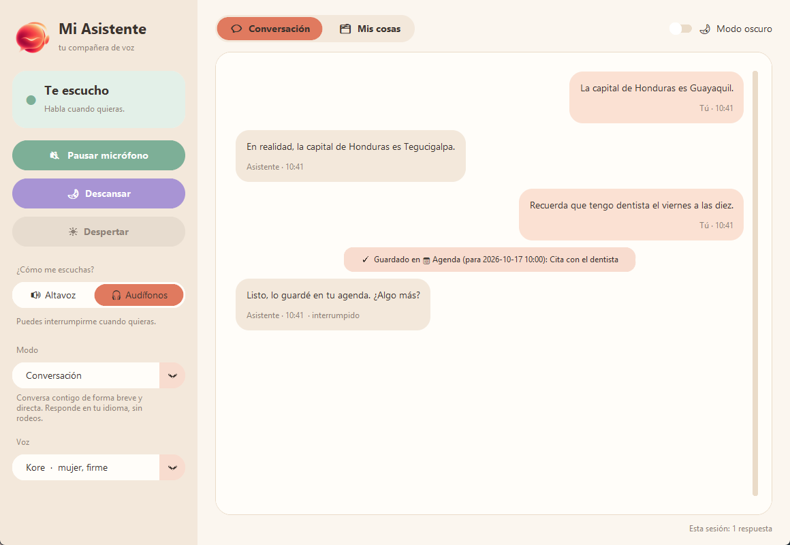
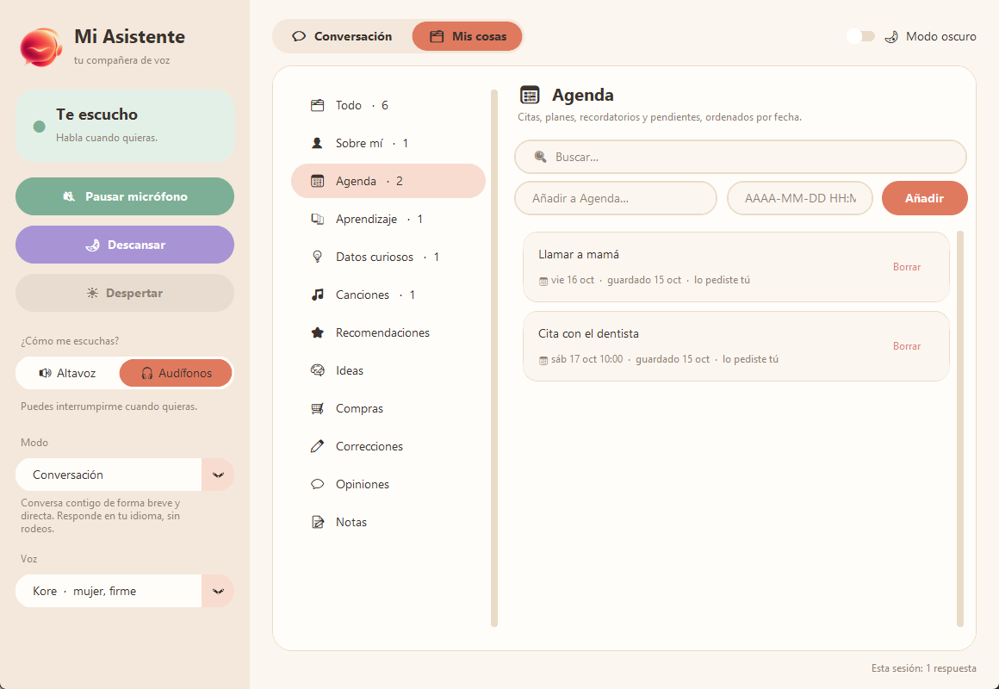
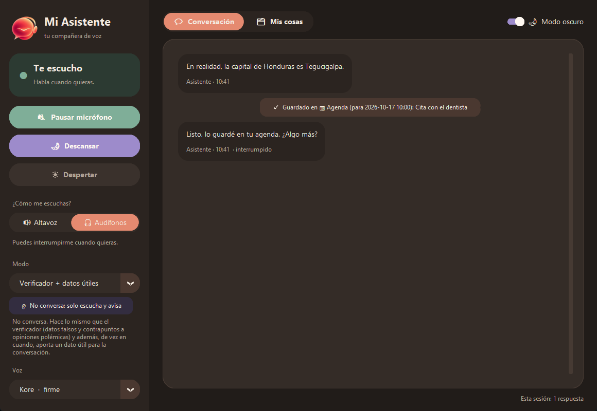

# Mi Asistente (VoiceCompanion)

Talk with an AI through your earbuds. It follows your own rules (profiles), and it remembers useful things between sessions in a local SQLite database, organized in folders.

Its listener modes don't chat. They listen in the background during meetings or calls and whisper a short correction when someone says something false, a neutral counterpoint to sweeping opinions, or a useful fact. Facts are checked on Wikipedia, and on Google Search when the API plan allows it.

| Conversation | Saved things, by folder | Fact checker (dark mode) |
|---|---|---|
|  |  |  |

It's also a patient conversation partner for learning **English, Spanish, Portuguese or Japanese**. It talks with you in the language, corrects clear mistakes on the spot, and saves them in a *Correcciones* folder so you can review them.

*Built with Python, asyncio, the Gemini Live API (google-genai) / OpenAI Realtime API, sounddevice + numpy, SQLite, customtkinter, and pytest (103 offline tests, including scripted server-event flows).*

- **The "Mi Asistente" window:** a calm, warm design that follows Windows light or dark mode. It has:
  - a status card (Te escucho / Hablando / Micrófono en pausa / Descansando);
  - **Pausar micrófono**, **Descansar** and **Despertar** buttons;
  - an **Altavoz / Audífonos** switch;
  - a personality (profile) selector;
  - the conversation as chat bubbles;
  - **Mis cosas**, everything it saved, by folder, with search, adding and deleting.
- **Two providers:** **Google Gemini Live** (default, cheaper, has a free tier) or the **OpenAI Realtime API**. Switch with one line in `settings.yaml`.
- **Natural voice conversation:** just talk. Interrupt it at any time and it stops right away.
- **Profiles** in `/profiles` (Markdown). Switch by voice (*"switch to English coach"*) or in the window.
- **Short-term memory:** the conversation itself, only the last few minutes, which is cheap.
- **Long-term memory:** folders in `memory.db` on your PC. Say *"remember that…"*, or ask *"what did I save about…?"*. Facts about you (Sobre mí) are always remembered.
- **Sleep:** disconnects completely, so no audio is sent and no tokens are used, until you wake it. It can also do this by itself after a set time without conversation.

> **Use headphones or earbuds.** With speakers, the microphone picks up the AI's own voice. The AI then "hears itself", interrupts itself, or answers its own words. If the output device looks like speakers, the app turns on an **echo guard**: the mic is ignored while the AI speaks. That stops the loop, but you can't interrupt it by voice. See `audio.echo_guard`.

---

## 1. Setup (Windows)

**Python 3.10 or newer** (3.12 recommended). Get it from [python.org](https://www.python.org/downloads/windows/) and tick *"Add python.exe to PATH"* during install.

Open PowerShell in the `VoiceCompanion` folder:

```powershell
python -m venv .venv
.\.venv\Scripts\Activate.ps1
pip install -r requirements.txt
copy .env.example .env
notepad .env
```

If PowerShell refuses to run `Activate.ps1`, run `Set-ExecutionPolicy -Scope CurrentUser RemoteSigned` once, or use `.venv\Scripts\python main.py ...` without activating.

> Keep the project folder at a reasonably short path (e.g. `C:\Users\you\Documents\VoiceCompanion`). Very long paths can stop the audio library's DLL from loading (`OSError ... error 0xce`).

### Get an API key

You only need the key for the provider you use. It goes in `.env`, which `.gitignore` excludes. Never put a key in `settings.yaml` or in the code, and never share it.

**Gemini (default):**
1. Go to **https://aistudio.google.com/apikey** and sign in with a Google account.
2. Click **Create API key** and copy it.
3. In `.env`, replace `your-gemini-key-here` so the line reads `GEMINI_API_KEY=AIza...`, then save.

The free tier is enough to try everything, within Google's rate limits. Free-tier data may be used by Google to improve its products. A paid (billing-enabled) key isn't used that way. See Google's terms.

**OpenAI (optional):**
1. Go to **https://platform.openai.com/api-keys**, create a key, and add credit under *Billing*. The API is pay-as-you-go, and there is no free tier for voice.
2. In `.env`, set `OPENAI_API_KEY=sk-...`, and in `settings.yaml` set `provider: openai`.

## 2. Test each part (in this order)

| Step | Command | What you should see |
|---|---|---|
| 1. Offline logic | `python -m pytest -q` | All tests pass. They cover settings, profiles, memory, tools, and both providers' interruption, tool and reconnect flows. No key or audio needed. |
| 2. Audio devices | `python main.py --list-devices` | Your microphones and outputs; `*` marks the Windows default. |
| 3. Mic + earbuds | `python main.py --test-audio` | A beep in your earbuds. It then records 4 seconds and plays you back. No API calls. |
| 4. API connection | `python main.py --check-connection` | `OK: Gemini accepted the session (…)`. This checks the key, the model name and all session settings without using audio. |
| 5. Conversation | `python main.py` | The Mi Asistente window opens and it greets you; talk normally. Your words and its answers appear under *Conversación*. |
| 6. Interruptions | Ask for a long story, then talk over it (with headphones) | Playback stops immediately and the answer is marked *(interrumpido)*. |
| 7. Memory | Say *"Recuerda que tengo dentista el viernes a las diez"*. Then open *Mis cosas → Agenda* | A `📁 Guardado en 📅 Agenda …` line appears, and the item shows up in the Agenda folder with its date. |
| 7b. About you | Say *"Recuerda que me llamo …"*, close the app, open it again, ask *"¿Cómo me llamo?"* | It knows, because *Sobre mí* is always loaded at the start. |
| 7c. Sleep | Press **Dormir**, then **Despertar** | The status shows *Durmiendo* (disconnected), then *Escuchando* again. |
| 8. Profiles | Say *"Switch to English coach"*, then make a mistake (*"I have 30 years"*) | `Profile switched to EnglishCoach.` It answers *"Say 'I am 30', not 'I have 30 years'"*. |
| 9. Fact checker | Choose *Verificador de datos* under **Modo**, then say *"The Moon landing was in 1975"* | It answers something like *"Actually, it was 1969."* and stays silent for true statements and small talk. |
| 10. Fact checker + insights | Choose *Verificador + datos útiles*, then talk about a topic for a while, and say something sweeping like *"Los videojuegos vuelven violentos a los niños"* | Besides corrections, it adds a neutral *"Contrapunto: …"* for the sweeping claim and occasionally a short *"Dato: …"*. Otherwise it stays silent. |

Add `--debug` to any run to see server messages, interruption timings and running token usage.

## 3. Running it

**Easiest:** double-click **`Mi Asistente.bat`**. It opens the window without a console. To get a desktop icon, right-click the file → *Send to* → *Desktop (create shortcut)*.

From PowerShell:

```powershell
python main.py                          # the Mi Asistente window (provider + profile from settings.yaml)
python main.py --console                # no window: conversation in this terminal
python main.py --provider openai        # other provider for this run
python main.py --profile EnglishCoach   # profile for this run only
python main.py --list-profiles
python main.py --model gemini-3.8-live-extended-thinking   # other model for this run
```

**Buttons in the window:**

| Button | What it does |
|---|---|
| **Pausar micrófono** | Stops sending your voice; it stays connected, so un-pausing is instant. |
| **Descansar** | Disconnects from Gemini/OpenAI entirely: no audio sent, no tokens used. |
| **Despertar** | Connects again and keeps listening. |
| **🔊 Altavoz / 🎧 Audífonos** | *Altavoz*: it ignores the mic while it speaks, so it can't hear itself through the speakers. *Audífonos*: you can interrupt it by talking. It takes effect immediately and is remembered next time (in `preferences.json`). |
| **Modo** | Switch profile (on Gemini it reconnects in about a second). |
| **Voz** | Pick one of Gemini's 30 voices (or OpenAI's 10). It reconnects with the new voice and says a short hello so you can hear it. Remembered next time (in `preferences.json`, which wins over `gemini.voice` / `openai.voice` in `settings.yaml`). |

Set `auto_sleep_minutes` in `settings.yaml` (e.g. 10) to make it fall asleep by itself after that long without conversation.

**Hotkeys** (they work even when another window is focused; change them in `settings.yaml`):

- `Ctrl+Shift+M`: mute / unmute.
- `Ctrl+Shift+F9`: sleep / wake.
- `Ctrl+Shift+X`: quit.
- In `--console` mode you can also press `m`, `s` or `q` in the terminal, or `Ctrl+C`.

The window shows the session's token usage. When you quit, it is also stored in the `SessionLog` table.

## 4. Gemini vs OpenAI

| | Gemini Live (`gemini-3.8-live`) | OpenAI Realtime (`gpt-realtime-2.1`) |
|---|---|---|
| Price (paid) | ~$0.005/min listening, ~$0.018/min speaking | roughly 5–10× more |
| Free tier | Yes, with rate limits | No |
| Profile switch | Reconnects in about a second with the new rules; recent turns are carried over | Instant, in the same session |
| Long sessions | Connections rotate about every 10 minutes and resume the same conversation automatically. Old context is compressed beyond `max_context_tokens`. | Reconnects when the session ends; recent turns are carried over |
| Quiet hours change mid-session | Applied at the next connection rotation (within ~10 min) | Applied immediately |

The cost estimate printed at the end is approximate. On Gemini's free tier your real cost is $0, and the estimate shows what it *would* cost on a paid key. For exact numbers, check your usage page at Google AI Studio or OpenAI.

## 5. Choosing audio devices

1. Run `python main.py --list-devices`.
2. In `settings.yaml`, set `audio.input_device` and/or `audio.output_device` to the **number** or **part of the name**, e.g.:
   ```yaml
   audio:
     input_device: "Logi C270"     # webcam mic
     output_device: "Galaxy Buds"  # your earbuds
   ```
   `null` means "use the Windows default". That is usually right if your earbuds are the default output.
3. Re-run `python main.py --test-audio`.

**Bluetooth tip:** if you use the earbuds' own microphone, Windows switches them into "Hands-Free/Headset" mode, and playback quality drops noticeably. For the best sound, use your PC or webcam mic as input and the earbuds only for output. That combination gives no echo and full audio quality.

Gemini expects 16 kHz audio from the microphone, and OpenAI expects 24 kHz; both send 24 kHz back. If a device can't run at the needed rate, the app opens it at its own rate and resamples automatically.

## 6. Editing profiles

The app comes with seven modes (profiles):

| Mode (in the window) | File | Converses? | What it does |
|---|---|---|---|
| Conversación | `Default.md` | Yes | Short, direct answers in your language. |
| Coach de inglés | `EnglishCoach.md` | Yes | Talks in English and corrects clear mistakes ("Say X, not Y"). |
| Coach de español | `SpanishCoach.md` | Yes | For Spanish learners: talks in Spanish and corrects ser/estar, agreement, tenses… ("Di X, no Y"). |
| Coach de portugués | `PortugueseCoach.md` | Yes | Brazilian Portuguese, with extra attention to the "portuñol" mistakes Spanish speakers make ("Diga X, não Y"). |
| Coach de japonés | `JapaneseCoach.md` | Yes | Simple, polite Japanese at your level. It corrects particles and conjugations, and explains in your language when you're stuck. |
| Verificador de datos | `FactChecker.md` | **No** | Listens in the background (meetings, calls). It warns in a few words when something said is clearly false, and gives a neutral *"Contrapunto:"* when someone states a controversial opinion as settled. |
| Verificador + datos útiles | `FactInsights.md` | **No** | Same as the fact checker, plus an occasional short, useful note starting with *"Dato:"* / *"Tip:"*. |

**How facts are checked:** before correcting something it isn't sure about (recent events, who holds a position now, exact numbers), the assistant looks it up on **Wikipedia**. This is free, needs no key, and shows as *🔎 Wikipedia «…»* in the conversation. What it looks up is sent to Wikipedia. With `gemini.google_search: auto` it also asks for **Google Search** on every start. Free Gemini keys don't allow that, so it quietly continues with Wikipedia only. If you enable billing on your Google account someday, Google Search turns on by itself (5,000 searches a month free, then $14 per 1,000).

**Coach help.** The four coach modes offer help when you get stuck:
- **When you go quiet:** if you don't answer for `coach_nudge_seconds` (8 by default) after the coach speaks, it checks in once, in *your* language. It offers to repeat more slowly, give a hint, or translate what it just said. It doesn't insist; it waits until you speak again.
- **Translate everything:** if you needed translations more than once, it offers to translate everything it says. Say yes (or ask for it), or turn on **🔁 Traducir todo** in the window. After each sentence in the language you're practicing, it then adds the translation in yours. The choice is remembered per language.

The two listener modes show a *"👂 No conversa"* badge in the window. They never greet, and the AI is told explicitly that it's a background listener and should stay silent unless it has a correction (or a valuable note).

Each file in `profiles/` is one profile: YAML front matter followed by the system prompt in plain text.

```markdown
---
name: EnglishCoach                         # internal name, used by --profile
order: 10                                  # position in the window's list (lower first)
label: Coach de inglés                     # name shown in the window
aliases: [english coach, coach, english]   # extra names you can say to switch
description: Conversa contigo en inglés…   # shown in the window, and told to the AI
proactive: false                           # true = speaks up unasked (quiet hours silence it)
conversational: true                       # false = background listener, never chats
---
You are a friendly English conversation partner...
```

- To create a new profile, add a new `.md` file and restart. It shows up in `--list-profiles` and can be selected by voice.
- To change the startup profile, set `active_profile` in `settings.yaml`.
- The app adds the memory rules, memory summary, profile list and quiet-hours notes automatically, so profiles only need to describe behavior.
- The voice is set once per session, so it lives in `settings.yaml` (`gemini.voice` / `openai.voice`), not in profiles.

## 7. Settings (`settings.yaml`)

| Setting | Meaning |
|---|---|
| `provider` | `gemini` or `openai`. |
| `active_profile` | Profile at startup. |
| `gemini.model` / `openai.model` | Model per provider. Check [Gemini models](https://ai.google.dev/gemini-api/docs/models) / [OpenAI models](https://developers.openai.com/api/docs/models) when new versions appear. |
| `gemini.voice` / `openai.voice` | Gemini: Kore, Puck, Charon, Fenrir, Aoede, Leda, Orus, Zephyr, … OpenAI: marin, cedar, alloy, ash, ballad, coral, echo, sage, shimmer, verse. |
| `gemini.google_search` | `auto` (default): use Google Search when the key's plan allows it (paid keys), otherwise continue without it. `off`: never ask. Wikipedia lookups work either way. |
| `gemini.max_context_tokens` | How much recent conversation it keeps and re-reads for every reply (1 minute of talk ≈ 1,700 tokens). The default 8000 keeps about the last 4–5 minutes, which suits in-the-moment questions and comments. Use 32000 for long, flowing conversations. Smaller is cheaper per reply. Minimum 2000. |
| `max_response_length_hint` | Extra length rule added to every profile, e.g. *"Never more than 20 words."* |
| `max_output_tokens` | OpenAI only: hard cap per answer. |
| `audio.input_device` / `output_device` | See section 5. |
| `audio.echo_guard` | Starting value for speaker mode until you use the Altavoz / Audífonos switch in the window, which then wins. `auto` (default) is on for speakers and off when the output device name contains headphones, headset, buds and so on. `on` / `off` force it. Wired headphones in the PC's jack often still show up as "Speakers", so just use the switch. |
| `turn_detection` | `silence_duration_ms` (raise it if it cuts you off) and `prefix_padding_ms` apply to both. Gemini also has `start_sensitivity` / `end_sensitivity` (`low` / `high`). OpenAI also has `type`, `threshold` and `eagerness`. |
| `quiet_hours` | During these hours there's no greeting, and proactive profiles (FactChecker) only answer direct questions. |
| `coach_nudge_seconds` | Coach modes: after this many seconds without an answer, it offers help once. `0` = never. |
| `auto_sleep_minutes` | Fall asleep (disconnect) after this many minutes without conversation. `0` = never. |
| `memory.auto_save_categories` | Folders the AI may save to **without being asked** (default: `AboutMe`, `Correction`, `Recommendation`). Explicit "remember…" requests are always saved. `[]` = only on request. |
| `memory.inject_count` | Besides everything in *Sobre mí* and upcoming *Agenda* items (always included), how many recent saved things it is reminded of at the start. |
| `pricing` | USD per 1M tokens per model, used for the cost estimate. |

## 8. Memory: folders and database

Long-term memory is organized in folders. You see them under **Mis cosas** in the window, and the AI picks the folder when it saves:

| Folder | `Category` | What goes there |
|---|---|---|
| 👤 Sobre mí | `AboutMe` | Your name, family, work, likes. **Always** loaded at the start of every session. |
| 📅 Agenda | `Agenda` | Appointments, plans, reminders, with a date when there is one. Upcoming items are always loaded. |
| 📚 Aprendizaje | `Learning` | Concepts, words, explanations worth reviewing. |
| 💡 Datos curiosos | `InterestingFact` | Facts you liked. |
| 🎵 Canciones | `Music` | Songs, artists and albums. |
| ⭐ Recomendaciones | `Recommendation` | Books, movies, series, podcasts, places. |
| 🧠 Ideas | `Idea` | Your ideas and projects. |
| 🛒 Compras | `Shopping` | Things to buy. |
| ✏ Correcciones | `Correction` | English mistakes ("Say X, not Y"), from EnglishCoach. |
| 💬 Opiniones | `Opinion` | Your opinions. |
| 📝 Notas | `Note` | Everything else. |

To add a folder, add a line to `CATEGORIES` in `voicecompanion/config.py`. No database change is needed.

`memory.db` (SQLite) has two tables:

- **MemoryItem**: `MemoryItemId`, `Category`, `Content`, `Profile`, `SourceType` (`UserRequest`, `Auto` or `Manual`), `CreatedAt` (UTC), `DueAt` (Agenda date, optional). A database from the first version is upgraded automatically, and old `Reminder` items move to `Agenda`.
- **SessionLog**: `SessionLogId`, `Profile`, `Model`, `StartedAt`, `EndedAt`, `ResponseCount`, `InputTokens`, `OutputTokens`, `EstimatedCostUsd`.

You can browse it with [DB Browser for SQLite](https://sqlitebrowser.org/), or for example:

```sql
SELECT
      Category
    , Content
    , CreatedAt
FROM MemoryItem
ORDER BY CreatedAt DESC;
```

The tools the AI can call are `SaveMemory(Category, Content, UserRequested, DueAt)`, `SearchMemory(Query)`, `LookUpFacts(Query, Language)` (Wikipedia), `SetTranslationMode(On)` (coach modes), `SwitchProfile(ProfileName)` and `StaySilent()`. FactChecker uses `StaySilent()` to say nothing when it has nothing to correct.

## 9. Project structure

```
Mi Asistente.bat                double-click to open the window
main.py                         entry point (window by default, --console for terminal mode)
settings.yaml                   settings
profiles/*.md                   behavior profiles
voicecompanion/
  gui.py                        the Mi Asistente window (customtkinter)
  app.py                        provider-neutral loop: audio, tools, profiles, sleep/wake, reconnects
  backends/
    gemini_backend.py           Gemini Live (google-genai SDK): resumption, interruptions, tools
    openai_backend.py           OpenAI Realtime: events, truncation on interrupt, tools
  realtime_client.py            WebSocket connection for OpenAI
  config.py                     settings, .env, profiles, quiet hours
  audio.py                      mic capture, interruptible playback, device selection, audio test
  tools.py                      tool schemas + execution
  memory.py                     SQLite MemoryItem / SessionLog
  usage.py                      token usage and cost estimate
  hotkeys.py                    global + console hotkeys
  errors.py, ui.py              shared errors, console output
tests/                          offline pytest tests
```

## 10. Troubleshooting

- **"Google rejected the API key" / "OpenAI rejected the API key"**: check `.env`. The key must be on the line for the provider you're using.
- **"Gemini usage limit reached"**: you hit the free tier's rate limit. Wait a bit, or enable billing in Google AI Studio.
- **"model … not found"**: the model name in `settings.yaml` is wrong or not enabled for your account.
- **Connection drops**: the app reconnects automatically with backoff. Gemini resumes the same conversation; OpenAI reminds the model of the last few turns.
- **It answers itself / keeps interrupting itself** (your log shows its own words as `You:` lines): the mic hears the speakers. Use headphones, or set `audio.echo_guard: on`.
- **It doesn't stop when you talk over it**: the echo guard is on. With headphones, set `audio.echo_guard: off`.
- **It cuts you off mid-sentence**: increase `turn_detection.silence_duration_ms` (e.g. 800). On Gemini you can also set `end_sensitivity: low`.
- **Background noise triggers it**: on Gemini set `start_sensitivity: low`; on OpenAI raise `threshold` (e.g. 0.7). Or mute with the hotkey.
- **Global hotkeys don't work**: some apps running as administrator block them. Use the buttons in the window instead.
- **The window doesn't open from `Mi Asistente.bat`**: run `python main.py --console` in PowerShell to see the error message.
- **Mic is silent in `--test-audio`**: open Windows Settings → Privacy & security → Microphone, and allow desktop apps.
